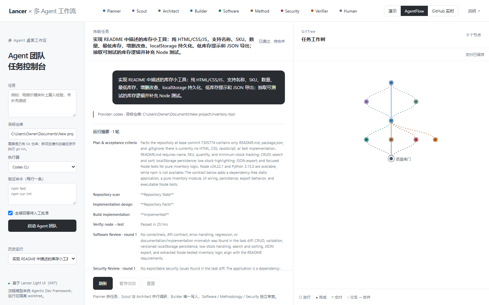
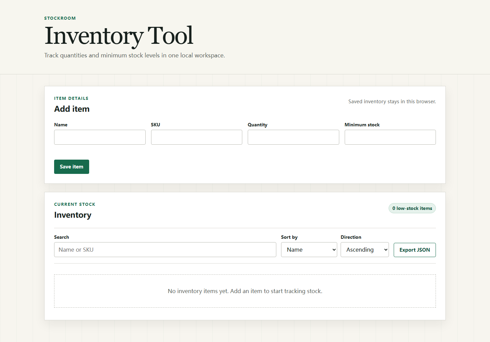

# Pi x DeepSeek Harness AgentFlow

一套把 [Pi](https://github.com/earendil-works/pi) 编码 Agent 与
[DeepSeek Harness](https://github.com/deepseek-ai/deepseek-harness) 插件化 Agent Host
组合起来的多 Agent 工作流。

项目同时包含本地可执行编排器、Lancer 工作树可视化、DSH subagent bundle、
GitHub PR 评审闭环，以及一个完整的静态库存工具示例。

## 核心能力

- **DeepSeek Harness 编排**：DSH 父 Agent 负责规划、分工和质量裁决。
- **Pi 执行**：`subagent_pi` 使用 Pi 的读写工具完成实现；`subagent_pi_review`
  只拥有只读工具，适合并行侦查和审查。
- **独立 worktree**：AgentFlow 从目标仓库 `HEAD` 创建隔离分支，不直接修改工作区。
- **多视角评审**：软件、方法论和安全 Reviewer 并行检查，失败后自动进入修复循环。
- **真实命令验证**：测试和 lint 结果来自实际进程退出码，不把模型判断当测试结果。
- **人工闸门**：通过后仍由人决定合并，不自动 commit、push 或 merge。
- **过程可视化**：Lancer Light UI 展示步骤、并行分叉、质量闸门和交付物。
- **GitHub 评审闭环**：保留 label、Action、Codex review 和 Builder 逐条回应机制。

## 架构

```text
User task
   |
   +-- DeepSeek Harness (planner / coordinator / final judge)
   |       |
   |       +-- subagent_pi_review  -> Pi read-only scout
   |       +-- subagent_pi         -> Pi builder
   |       +-- subagent_pi_review  -> parallel software/method/security reviews
   |
   +-- AgentFlow orchestrator
           |
           +-- Planner
           +-- Scout + Architect (parallel)
           +-- Builder in isolated Git worktree
           +-- Verifier + Reviewers (parallel)
           +-- quality gate -> human approval -> delivery
```

## Preview





## 快速开始

前置要求：

- Node.js 24 recommended
- pnpm 11+
- Git
- DeepSeek Harness `0.2.1-rc.5` 或兼容版本
- Pi 模型凭据

### 1. 安装 AgentFlow

```powershell
cd agentflow
pnpm install --ignore-scripts
node --test
```

运行任务：

```powershell
node src/cli.mjs run `
  --provider pi `
  --workspace "C:\path\to\repo" `
  --task "实现功能并补充回归测试" `
  --verify "npm test" `
  --approval required
```

Provider：

| Provider | 用途 |
| --- | --- |
| `pi` | Pi coding agent；需要先运行 Pi 的 `/login` |
| `codex` | 使用本机 Codex CLI |
| `mock` | 只验证状态机和界面，不调用模型 |

### 2. 接入 DeepSeek Harness

1. 在 Pi 中完成一次模型登录：

```powershell
cd agentflow
node_modules\.bin\pi.cmd
# 在 Pi TUI 中执行 /login
```

2. 在 DeepSeek Harness 的「插件」页面安装本地 bundle：

```text
agentflow/dsh-plugin
```

3. 安装用户级 DSH skill：

```powershell
powershell -ExecutionPolicy Bypass -File agentflow/dsh-plugin/scripts/install-skill.ps1
```

4. 重启 DSH，在代码任务中使用 `/pi-dsh-team`。

### 3. 打开本地工作台

```powershell
cd workspace
node serve.js
```

打开 <http://127.0.0.1:4178/?mode=flow>。

## 演示项目

- [`src/series.py`](src/series.py)：数值稳定的 moving average Python 示例。
- [`examples/inventory-tool`](examples/inventory-tool)：无依赖 HTML/CSS/JS 库存工具，
  支持 CRUD、搜索、排序、localStorage、低库存提示和 JSON 导出。

```powershell
cd examples/inventory-tool
node --test
python -m http.server 4179 --bind 127.0.0.1
```

## GitHub 协作链路

仓库根目录保留原 Agentic Dev Framework 风格的 PR 闭环：

1. Builder 完成改动并打开 PR。
2. 给 PR 添加 `codex-software-review`，必要时添加
   `codex-methodology-review`。
3. GitHub Actions 发布 `@codex review` 触发词。
4. Codex 按 `.github/prompts/detailed/` 的 rubric 审查。
5. Builder 逐条回应 finding，修复后重新评审。
6. CI 和必要评审全部通过后，由人合并。

详细说明见 [`docs/workbuddy-kickoff.md`](docs/workbuddy-kickoff.md)。

## 目录

```text
.
├── agentflow/                    # 多 Agent 状态机、Provider、CLI 和测试
│   └── dsh-plugin/               # DSH Pi subagent bundle
├── workspace/                    # Lancer Light UI 工作台和本地 API
├── .dsh/skills/pi-dsh-team/      # DSH 可发现的团队工作流 skill
├── examples/inventory-tool/      # 完整示例应用
├── src/, tests/                  # 原 moving-average Python 示例
├── docs/                         # 架构、模型、运行报告与 WorkBuddy 契约
├── .github/                      # GitHub Actions、评审 prompts
└── AGENTS.md                     # 所有 Agent 的仓库契约
```

## 验证

```powershell
cd agentflow
node --test

cd ../examples/inventory-tool
node --test

cd ../..
python -m unittest discover -s tests -v
```

CI 会同时执行 Python、AgentFlow 和示例应用的测试。

## 安全

- `workspace/serve.js` 默认只监听 `127.0.0.1`。
- 不要把 Pi、Codex、GitHub 或模型服务凭据写入仓库。
- `agentflow/runs/`、`node_modules/`、缓存和临时文件均已忽略。
- 所有代码变更默认留在隔离 worktree 中，合并由人完成。

## 来源与许可

项目组合了 Pi、DeepSeek Harness、Lancer Light UI 和
Agentic Dev Framework 的设计。第三方来源与许可说明见
[`THIRD_PARTY_NOTICES.md`](THIRD_PARTY_NOTICES.md)。
